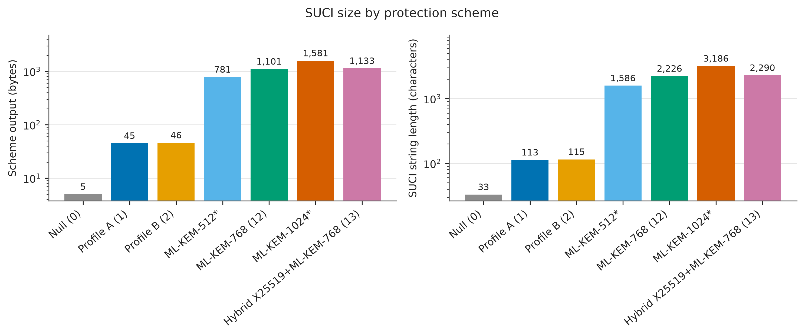
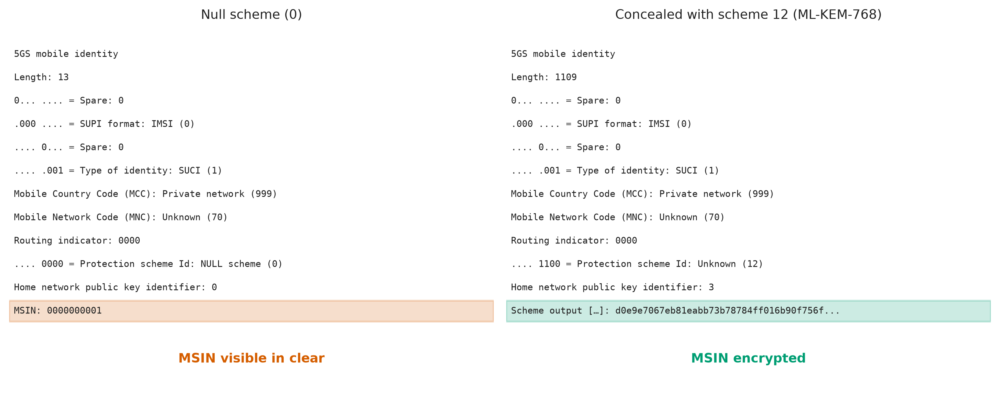

# pq-suci-5g

Post-quantum subscriber identity protection (SUCI) for 5G, tested on a real open-source 5G standalone core (Open5GS) with a simulated radio and phone (UERANSIM).

## What this is

This project replaces the elliptic-curve encryption that hides a subscriber's identity in 5G with post-quantum alternatives, and measures what that costs. It runs a full 5G core network, a simulated base station and simulated phones on one Linux machine, so every change can be tested end to end.

Parts:

- `pqsuci`: a Python package with ECIES Profile A and Profile B (the current schemes), ML-KEM scheme 12 and hybrid scheme 13 (X25519 + ML-KEM-768).
- Patches for Open5GS v2.8.0 and UERANSIM v3.3.0 that add the new schemes and Profile B on the UE side.
- Scripts to build everything and run a 5G core on one machine.
- Experiments and figure scripts.

## Why

The SUPI (Subscription Permanent Identifier) is the permanent identity of a subscriber, in practice the IMSI. To avoid sending it in clear text over the radio, the phone encrypts it with the home network's public key. The result is the SUCI (Subscription Concealed Identifier). The current schemes use ECIES (Elliptic Curve Integrated Encryption Scheme).

A large quantum computer could break the elliptic-curve step. An attacker can record SUCIs today and decrypt them later ("harvest now, decrypt later"). The SUPI does not change for years, so old recordings stay useful.

This project measures:

- Size: how much larger the SUCI gets.
- Compute cost: how much CPU time concealing and de-concealing takes.
- Interoperability: whether a real 5G core can carry and process the new SUCI.
- Capacity effect: how registration load changes with the new schemes.

## Use cases

- Evaluating the cost of post-quantum identity protection.
- A working lab setup to see SUPI and SUCI on the wire in Wireshark.
- A starting point for testing new protection schemes in Open5GS and UERANSIM.
- Teaching 5G security.

## Status

Research prototype. Schemes 12 and 13 are not standardized. They use the protection scheme ID range that is reserved for home network proprietary schemes. The test keys in `config/keys/` are for testing only.

## Requirements

- Linux x86-64. Tested on Ubuntu 26.04 under WSL2. The same commands apply on native Ubuntu.
- SCTP kernel module (`sudo modprobe sctp`).
- `/dev/net/tun`.
- `sudo` access.
- About 10 GB of disk and at least 4 GB of RAM.

## Installation

```bash
git clone https://github.com/raj-atg/pq-suci-5g.git
cd pq-suci-5g
make setup        # apt packages (including MongoDB 9.0 from MongoDB's repository) and uv
make build        # liboqs, Open5GS, UERANSIM, then the patched builds
make keys         # test key pairs and UERANSIM UE configs
make core-up      # start MongoDB and the 5G core
make subscribers  # add 120 test subscribers
make test         # unit tests
experiments/run_registration.sh -c config/ueransim/ue-profileA.yaml -o /tmp/demo -p
make core-down    # stop everything
```

The last command starts a gNB and one UE, registers it with Profile A, pings through the tunnel, and writes a capture and logs to `/tmp/demo.*`. See [docs/04-setup.md](docs/04-setup.md) for details and troubleshooting.

## Repository layout

```
src/pqsuci/       crypto package: KDF, ECIES, ML-KEM scheme, SUCI format, CLI
patches/          patches for Open5GS v2.8.0 and UERANSIM v3.3.0
config/open5gs/   Open5GS network function configs
config/ueransim/  gNB and UE configs
config/keys/      TEST ONLY home network keys
scripts/          setup, build, start/stop core, subscribers, helpers
experiments/      experiment runners and the registration script
bench/            microbenchmarks
tests/            unit tests
docs/             documentation
results/          raw data, processed CSV files, figures
```

## Results

<!-- RESULTS: filled in after experiments -->

Figures:

- 
- 

<!-- RESULTS: the remaining figures (fig2 to fig8) are added after experiments -->

## Documentation

- [01 5G architecture](docs/01-5g-architecture.md)
- [02 SUCI explained](docs/02-suci-explained.md)
- [03 Post-quantum design](docs/03-pq-design.md)
- [04 Setup and troubleshooting](docs/04-setup.md)
- docs/05 to docs/08: added as the project grows
- [Glossary](docs/glossary.md)
- [Decisions](docs/decisions.md)
- [Versions](docs/versions.md)

## License

MIT for the code in this repository. The files in `patches/` modify Open5GS (AGPL-3.0) and UERANSIM (GPL-3.0) and stay under those licenses.

## Windows/WSL note

On WSL, `scripts/sync_to_windows.sh` can copy the repository files to a Windows folder so they can be browsed in File Explorer. It is optional and only runs when `config/export.env` exists (copy it from `config/export.env.example` and set the path). On native Linux it does nothing.
