# pq-suci-5g

Post-quantum subscriber identity protection (SUCI) for 5G, tested on a real open-source 5G standalone core (Open5GS) with a simulated radio and phone (UERANSIM).

## What this is

This project replaces the elliptic-curve encryption that hides a subscriber's identity in 5G with post-quantum alternatives, and measures what that costs. It runs a full 5G core network, a simulated base station and simulated phones on one Linux machine, so every change can be tested end to end.

Parts:

- `pqsuci`: a Python package with ECIES Profile A and Profile B (the current schemes), ML-KEM scheme 12 and hybrid scheme 13 (X25519 + ML-KEM-768).
- Patches for Open5GS v2.8.0 and UERANSIM v3.3.0 that add the new schemes and Profile B on the UE side.
- Scripts to build everything and run a 5G core on one machine.
- Experiments and figure scripts.

## Why

The SUPI (Subscription Permanent Identifier) is the permanent identity of a subscriber, in practice the IMSI. To avoid sending it in clear text over the radio, the phone encrypts it with the home network's public key. The result is the SUCI (Subscription Concealed Identifier). The current schemes use ECIES (Elliptic Curve Integrated Encryption Scheme).

A large quantum computer could break the elliptic-curve step. An attacker can record SUCIs today and decrypt them later ("harvest now, decrypt later"). The SUPI does not change for years, so old recordings stay useful.

This project measures:

- Size: how much larger the SUCI gets.
- Compute cost: how much CPU time concealing and de-concealing takes.
- Interoperability: whether a real 5G core can carry and process the new SUCI.
- Capacity effect: how registration load changes with the new schemes.

For the cryptography (elliptic curves, ECIES, the quantum threat, ML-KEM and lattices), prior
work, the 5G message flows, how the architecture is changed to carry a post-quantum SUCI, and
the findings, read [docs/09-technical-deep-dive.md](docs/09-technical-deep-dive.md).

## Main findings

1. **A real 5G core can register a UE with a post-quantum SUCI.** With ML-KEM-768 (scheme 12) the
   UE registered on Open5GS, the home network recovered the subscriber identity, and the data
   session worked.
2. **The cost is size, not speed.** The concealed identity grows from 45 to 1101 bytes, but
   ML-KEM-768 was faster than the current elliptic-curve schemes on both the UE and the network
   side, and registration latency and core CPU under 100 simultaneous UEs were not worse.
3. **The radio pays for the size.** The extra 1056 bytes cost up to 10 extra uplink slots (5 ms)
   for a UE with a small grant in our model, about one slot otherwise.
4. **Open-source 5G software assumed elliptic-curve sizes.** Fixed scheme lists, an 8-bit size
   variable, a 32-byte key slot and a 69-byte KDF buffer had to be fixed in the UE, the serving
   AMF and the UDM. Because the Open5GS serving AMF rejects unknown scheme IDs, a home network
   cannot deploy such a scheme by changing only its own UDM if visited networks behave the same.
5. **Real-world blockers are SIMs, devices and standards, not cryptography.** A private 5G
   network that controls its SIMs, devices and core could deploy it now; public networks with
   roaming need a standardized profile and new SIMs and modems.

Details: results and discussion in [docs/07](docs/07-results-and-discussion.md), real-world
deployment and blockers in [docs/10](docs/10-real-world-deployment.md), all numbers in
[results/processed/summary.csv](results/processed/summary.csv).

## Use cases

- Evaluating the cost of post-quantum identity protection.
- A working lab setup to see SUPI and SUCI on the wire in Wireshark.
- A starting point for testing new protection schemes in Open5GS and UERANSIM.
- Teaching 5G security.

## Status

Research prototype. Schemes 12 and 13 are not standardized. They use the protection scheme ID range that is reserved for home network proprietary schemes. The test keys in `config/keys/` are for testing only.

## Requirements

- Linux x86-64. Tested on Ubuntu 26.04 under WSL2. The same commands apply on native Ubuntu.
- SCTP kernel module (`sudo modprobe sctp`).
- `/dev/net/tun`.
- `sudo` access.
- About 10 GB of disk and at least 4 GB of RAM.

## Installation

```bash
git clone https://github.com/raj-atg/pq-suci-5g.git
cd pq-suci-5g
make setup        # apt packages (including MongoDB 9.0 from MongoDB's repository) and uv
make build        # liboqs, Open5GS, UERANSIM, then the patched builds
make keys         # test key pairs and UERANSIM UE configs
make core-up      # start MongoDB and the 5G core
make subscribers  # add 120 test subscribers
make test         # unit tests
experiments/run_registration.sh -c config/ueransim/ue-profileA.yaml -o /tmp/demo -p
make core-down    # stop everything
```

The last command starts a gNB and one UE, registers it with Profile A, pings through the tunnel, and writes a capture and logs to `/tmp/demo.*`. See [docs/04-setup.md](docs/04-setup.md) for details and troubleshooting.

## Repository layout

```
src/pqsuci/       crypto package: KDF, ECIES, ML-KEM scheme, SUCI format, CLI
patches/          patches for Open5GS v2.8.0 and UERANSIM v3.3.0
config/open5gs/   Open5GS network function configs
config/ueransim/  gNB and UE configs
config/keys/      TEST ONLY home network keys, generated locally by `make keys` (not committed)
scripts/          setup, build, start/stop core, subscribers, helpers
experiments/      experiment runners and the registration script
bench/            microbenchmarks
tests/            unit tests
docs/             documentation
results/          raw data, processed CSV files, figures
```

## Results

Measured on one laptop (Intel Core i3-1005G1, Ubuntu 26.04 on WSL2). Values from
[`results/processed/summary.csv`](results/processed/summary.csv); discussion in
[docs/07-results-and-discussion.md](docs/07-results-and-discussion.md).

| | Profile A (1) | Profile B (2) | ML-KEM-768 (12) |
|---|---|---|---|
| Scheme output (bytes) | 45 | 46 | 1101 |
| SUCI string in the SBI URI (characters) | 113 | 115 | 2226 |
| NAS Registration Request (bytes, measured) | 65 | 66 | 1121 |
| Conceal, Python (us, median) | 92.0 | 142.7 | 41.8 |
| De-conceal in the Open5GS UDM (us, median) | 598.5 | 1557.0 | 90.5 |
| Registration, 1 UE (ms, median of 30) | 29.2 | 27.5 | 26.2 |
| Registration, 100 simultaneous UEs (ms, median) | 805.7 | 806.2 | 725.7 |
| UDM CPU per UE, 100 UEs (ms) | 5.40 | 6.07 | 4.07 |
| Registers on the real core | yes (stock) | yes (patched UE) | yes (patched UE, AMF, UDM) |

In short:

- **Size is the cost.** The post-quantum SUCI is about 24 times larger. With a small uplink grant
  that is up to 10 extra 0.5 ms slots on the radio (model, `results/processed/e5_airtime.csv`).
- **CPU time is not.** ML-KEM-768 was faster than both ECIES profiles, in Python and inside Open5GS.
- **A real core can carry it.** Nothing in NAS, NGAP or the HTTP/2 service interface limited the
  1.1 kB SUCI. What had to change were hardcoded scheme lists and fixed key and buffer sizes in the
  UE, the AMF and the UDM, listed with file and line in
  [docs/05-tier3-integration.md](docs/05-tier3-integration.md).

### Figures

| | |
|---|---|
|  | 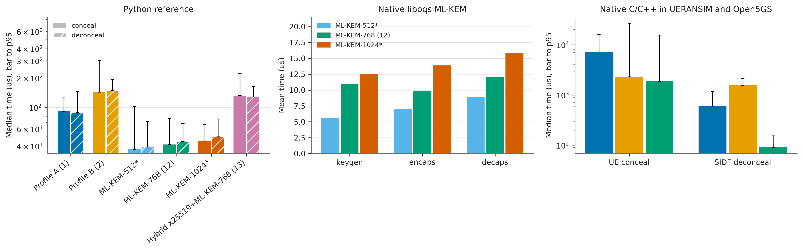 |
| Fig. 1: SUCI size per scheme | Fig. 2: conceal and de-conceal time (Python, liboqs, in-stack) |
| 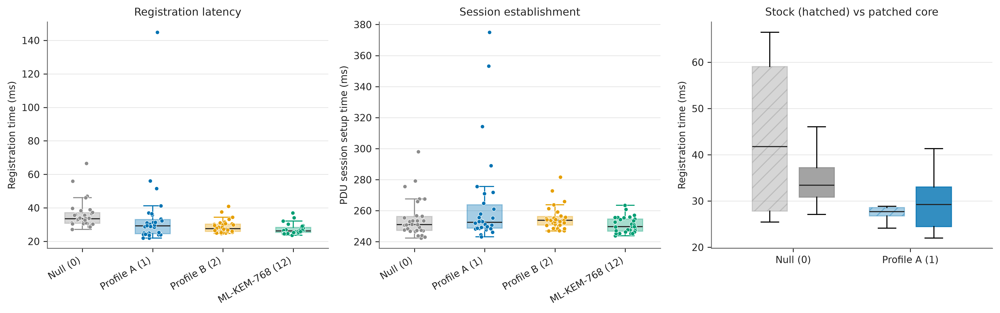 | 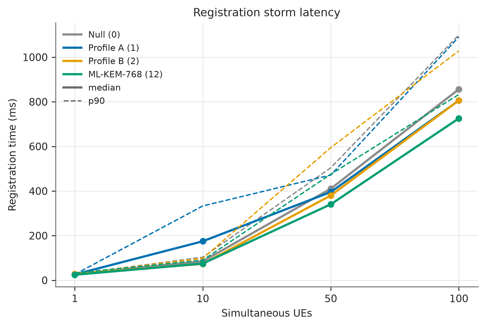 |
| Fig. 3: single-UE registration latency | Fig. 4: latency vs simultaneous UEs |
| 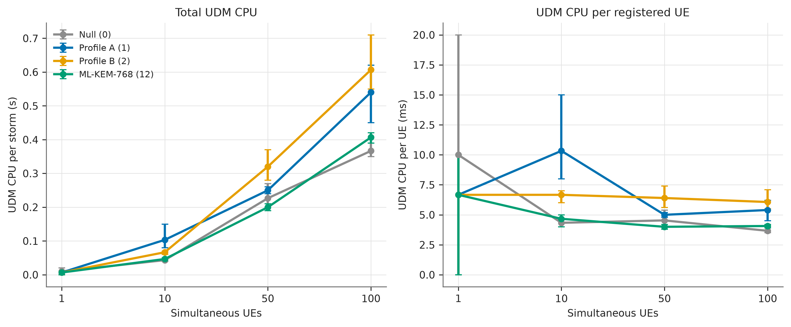 | 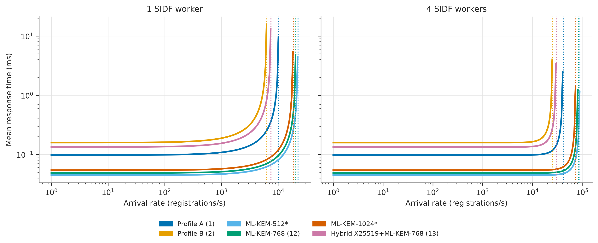 |
| Fig. 5: UDM CPU during attach storms | Fig. 6: SIDF capacity model (M/M/c) |
| 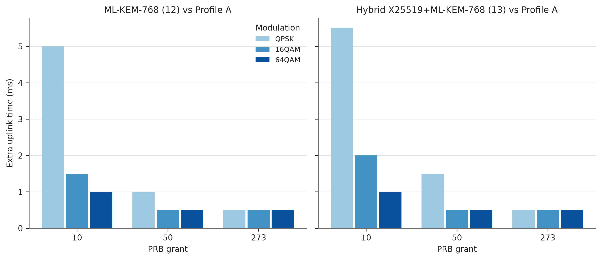 |  |
| Fig. 7: extra uplink airtime (model) | Fig. 9: what an eavesdropper sees |

Fig. 8 is the registration sequence diagram in [docs/09](docs/09-technical-deep-dive.md#71-where-the-suci-travels).

### Testbed evidence: Open5GS, UERANSIM and Wireshark/tshark

Generated from the real captures and logs of the runs; explained in
[docs/11-testbed-evidence.md](docs/11-testbed-evidence.md).

| | |
|---|---|
| 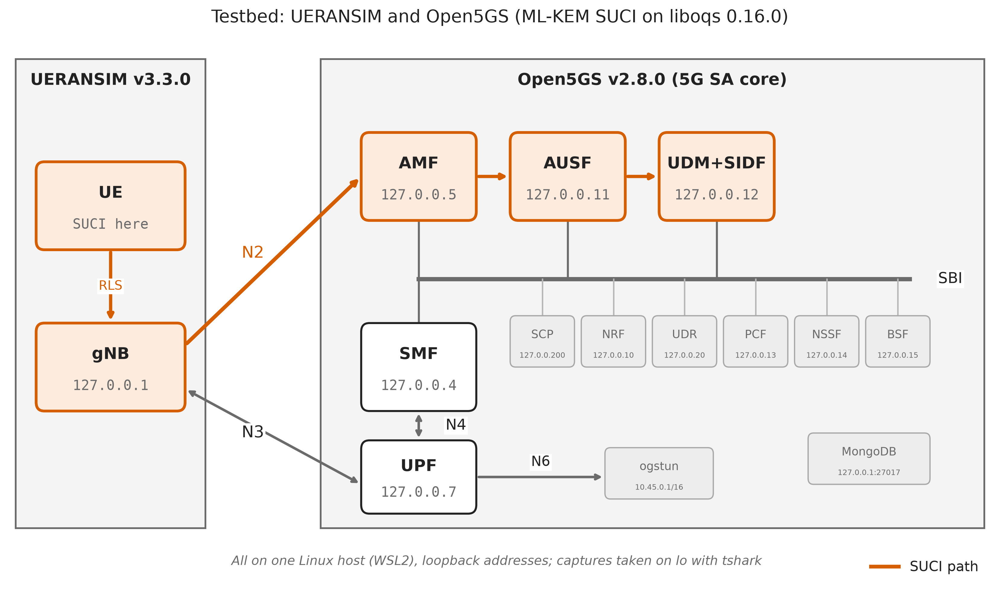 | 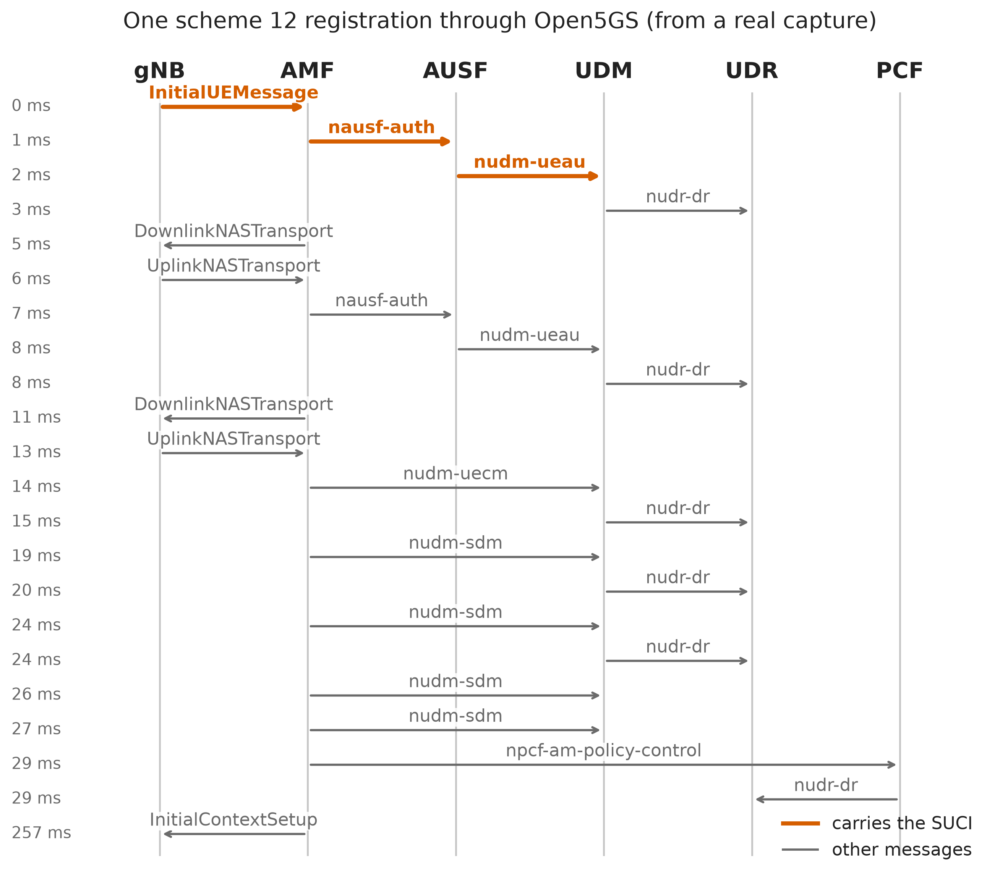 |
| Fig. 10: deployed testbed (Open5GS NFs, UERANSIM gNB and UE) | Fig. 11: one scheme 12 registration through Open5GS |
| 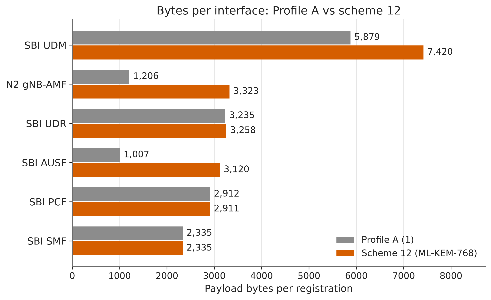 | 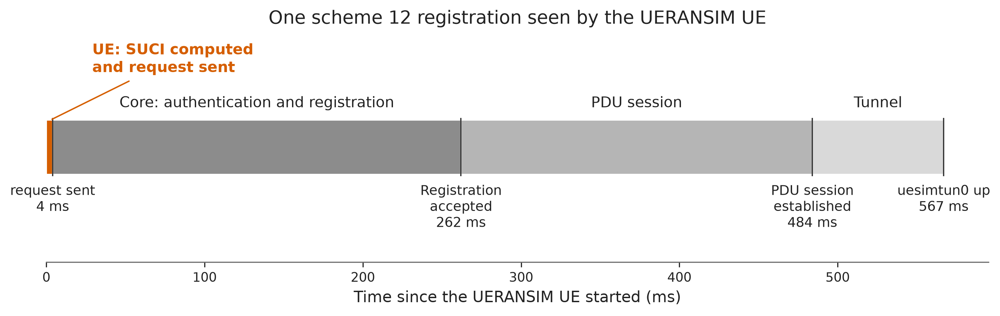 |
| Fig. 12: bytes per interface and scheme | Fig. 13: registration phases seen by the UERANSIM UE |
| 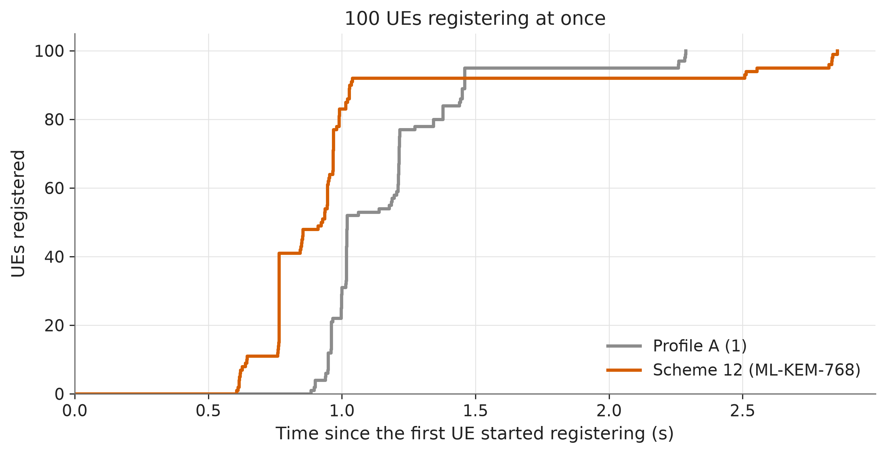 | 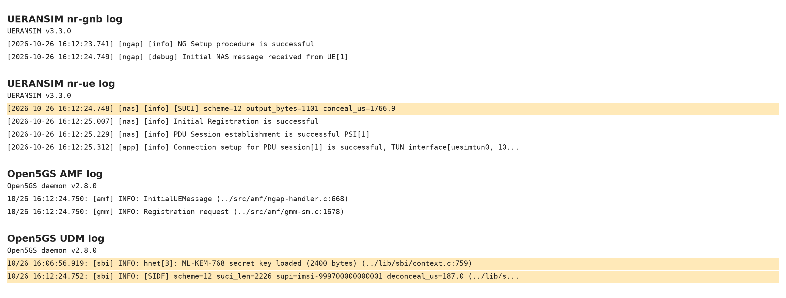 |
| Fig. 14: 100 UEs registered by the AMF over time | Fig. 15: Open5GS and UERANSIM log lines |
| 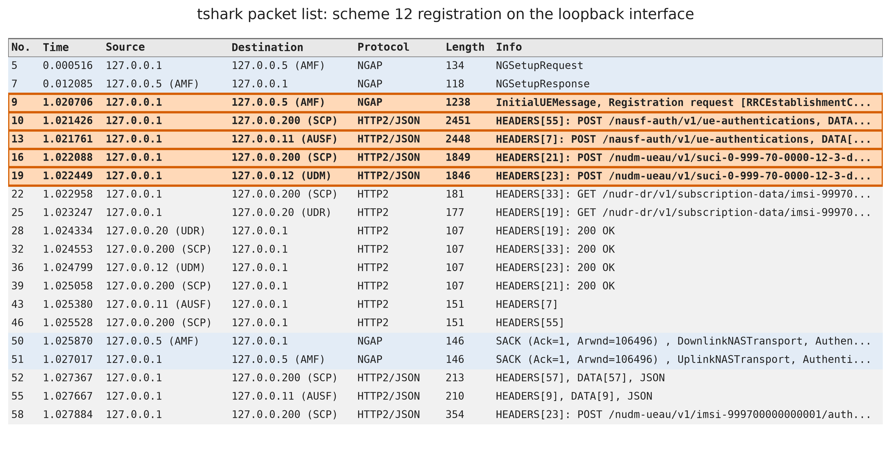 | 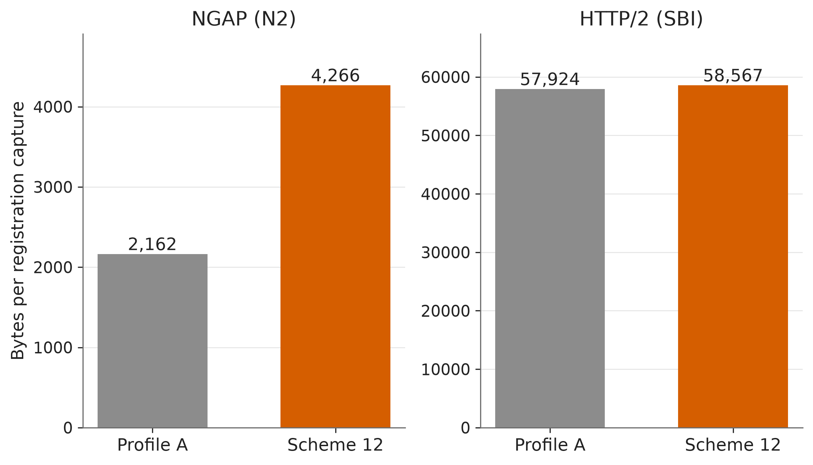 |
| Fig. 16: tshark packet list of the registration | Fig. 17: tshark protocol hierarchy per scheme |
| 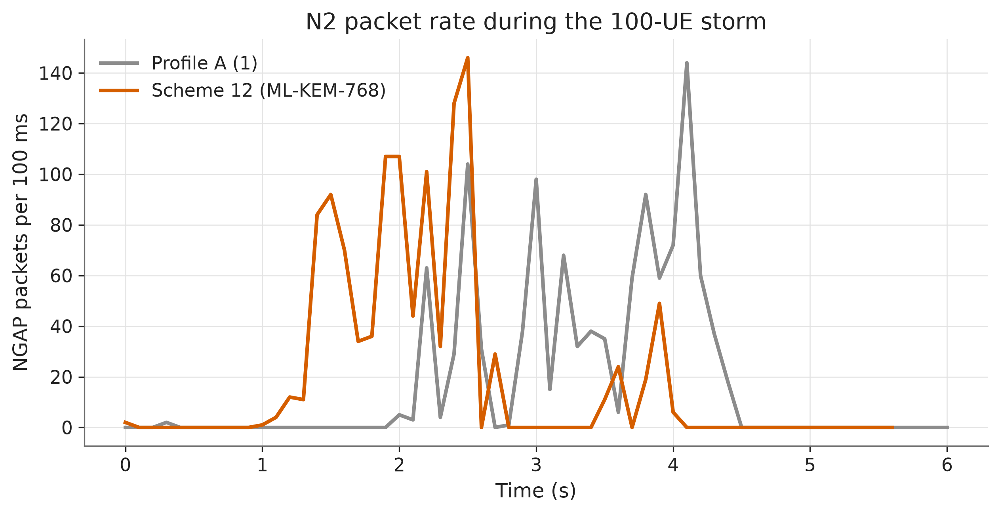 | |
| Fig. 18: Wireshark-style I/O graph of the storms | |

## Documentation

- [01 5G architecture](docs/01-5g-architecture.md)
- [02 SUCI explained](docs/02-suci-explained.md)
- [03 Post-quantum design](docs/03-pq-design.md)
- [04 Setup and troubleshooting](docs/04-setup.md)
- [05 Tier 3 integration: code changes and limits found](docs/05-tier3-integration.md)
- [06 Experiments: method and metrics](docs/06-experiments.md)
- [07 Results and discussion](docs/07-results-and-discussion.md)
- [08 Limitations and lab plan](docs/08-limitations-and-lab.md)
- [09 Technical deep dive: cryptography, 5G integration, prior work and findings](docs/09-technical-deep-dive.md)
- [10 Real-world deployment: what blocks it and migration paths](docs/10-real-world-deployment.md)
- [11 The testbed in action: Open5GS, UERANSIM and Wireshark/tshark](docs/11-testbed-evidence.md)
- [Glossary](docs/glossary.md)
- [Decisions](docs/decisions.md)
- [Versions](docs/versions.md)

## License

MIT for the code in this repository. The files in `patches/` modify Open5GS (AGPL-3.0) and UERANSIM (GPL-3.0) and stay under those licenses.

## Windows/WSL note

On WSL, `scripts/sync_to_windows.sh` can copy the repository files to a Windows folder so they can be browsed in File Explorer. It is optional and only runs when `config/export.env` exists (copy it from `config/export.env.example` and set the path). On native Linux it does nothing.
