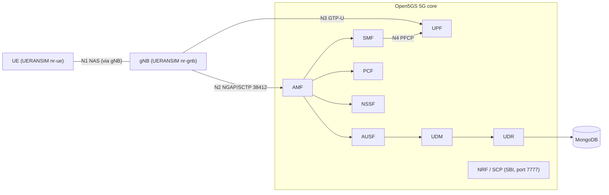

# 01. 5G architecture

## The 5G standalone core

A 5G standalone (SA) core is built from small services called network functions (NFs). Most of them talk to each other over HTTP/2 using a service-based interface (SBI). This project runs the 5G core of Open5GS v2.8.0 on one machine. Every NF listens on its own loopback address.

| NF | Role | Address (from `config/open5gs/*.yaml`) |
|---|---|---|
| NRF (Network Repository Function) | Registry: NFs register here and find each other | 127.0.0.10 |
| SCP (Service Communication Proxy) | Routes SBI requests between NFs | 127.0.0.200 |
| AMF (Access and Mobility Management Function) | Terminates NAS and NGAP, handles registration | 127.0.0.5 |
| SMF (Session Management Function) | Sets up PDU sessions, controls the UPF | 127.0.0.4 |
| UPF (User Plane Function) | Forwards user data, ends the GTP-U tunnel | 127.0.0.7 |
| AUSF (Authentication Server Function) | Runs 5G-AKA authentication | 127.0.0.11 |
| UDM (Unified Data Management) | Holds the SIDF (de-conceals SUCI) and creates auth vectors | 127.0.0.12 |
| UDR (Unified Data Repository) | Stores subscriber data in MongoDB | 127.0.0.20 |
| PCF (Policy Control Function) | Policy rules | 127.0.0.13 |
| NSSF (Network Slice Selection Function) | Selects network slices | 127.0.0.14 |
| BSF (Binding Support Function) | Tracks which PCF serves which session | 127.0.0.15 |

## Interfaces

| Name | Between | Protocol | Notes |
|---|---|---|---|
| N1 | UE and AMF | NAS (Non-Access Stratum) | Carries the registration request with the SUCI |
| N2 | gNB and AMF | NGAP over SCTP | Port 38412 |
| N3 | gNB and UPF | GTP-U | User data tunnel |
| N4 | SMF and UPF | PFCP | Session control |
| SBI | NF to NF | HTTP/2 | Port 7777 |

## Overview

All NFs use the SBI and register with the NRF. The arrows show the main call paths only.

## Mapping to real equipment

| In this project | In a real network |
|---|---|
| UERANSIM `nr-ue` | A phone (UE: User Equipment) with a USIM |
| UERANSIM `nr-gnb` | A 5G base station (gNB) |
| Open5GS NFs | The operator's 5G core |
| Loopback addresses | Links between data centers |
| Network namespace and `uesimtun0` | The phone's data interface |

The radio link is not simulated at the physical layer. UERANSIM passes the same NAS and RRC-level messages in software.

## Where MongoDB fits

Subscriber records (IMSI, key K, OPc, slice and session settings) are stored in MongoDB. Only the UDR reads them. The UDM and AUSF ask the UDR over the SBI. `scripts/add_subscribers.sh` writes records with the Open5GS `open5gs-dbctl` tool.
