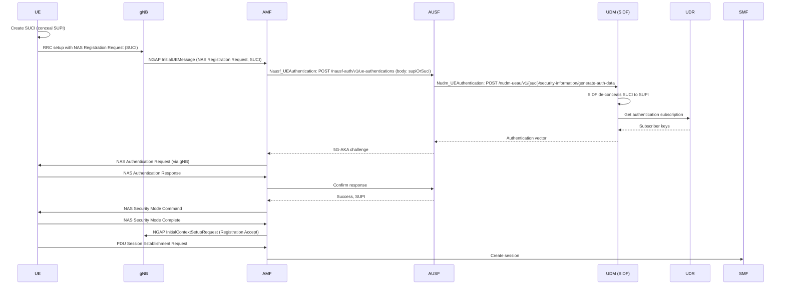

# 02. SUCI explained

## SUPI and SUCI

The SUPI (Subscription Permanent Identifier) is the permanent subscriber identity. In most networks it is the IMSI (International Mobile Subscriber Identity). The SUCI (Subscription Concealed Identifier) is the SUPI with the secret part encrypted. The phone sends the SUCI instead of the SUPI.

An IMSI has three parts:

| Part | Meaning | Example |
|---|---|---|
| MCC | Mobile Country Code | 999 |
| MNC | Mobile Network Code | 70 |
| MSIN | Mobile Subscription Identification Number | 0000000001 |

Example IMSI: 999-70-0000000001. Only the MSIN is encrypted. MCC and MNC stay visible so the serving network can route the request to the home network.

## IMSI catchers

An IMSI catcher is a fake base station. In older generations, phones send the IMSI in clear text when asked, so a catcher can collect them and track people. In 5G the phone sends a SUCI. A fresh ephemeral key is used each time, so two SUCIs from the same phone look different and cannot be linked without the home network private key.

## SUCI format

A SUCI is a text string with these fields:

```
suci-0-<MCC>-<MNC>-<routing indicator>-<scheme ID>-<home network key ID>-<scheme output>
```

In the NAS 5GS mobile identity information element, the same fields are binary: identity type SUCI, MCC and MNC, routing indicator, protection scheme ID, home network public key ID, and the scheme output.

Protection scheme IDs:

| ID | Meaning |
|---|---|
| 0 | Null scheme (no encryption) |
| 1 | ECIES Profile A (X25519) |
| 2 | ECIES Profile B (secp256r1, also called P-256) |
| 3 to 11 | Reserved |
| 12 to 15 | Home network proprietary |

This project uses 12 (ML-KEM-768) and 13 (X25519 + ML-KEM-768). They are a research prototype, not standardized. See [03-pq-design.md](03-pq-design.md).

## MSIN encoding

The MSIN digits are encoded as BCD (binary-coded decimal) with swapped nibbles before encryption. A 10-digit MSIN becomes 5 bytes. This was checked against UERANSIM `src/ue/nas/mm/identity.cpp` and `lib/nas/base.cpp` (`EncodeBcdString`).

## ECIES step by step

ECIES (Elliptic Curve Integrated Encryption Scheme) is used in the form given in TS 33.501 Annex C. The home network has a key pair. The public key is stored on the USIM (Universal Subscriber Identity Module).

UE side:

1. Generate an ephemeral key pair.
2. Compute the ECDH (Elliptic Curve Diffie-Hellman) shared secret with the home network public key.
3. Run a KDF (key derivation function, ANSI X9.63 with SHA-256) over the shared secret. The ephemeral public key is used as shared info. The output is split into an encryption key, an ICB (initial counter block) and a MAC key.
4. Encrypt the MSIN with AES-128 in CTR mode.
5. Compute a MAC (message authentication code, HMAC-SHA-256 truncated to an 8-byte tag) over the ciphertext.
6. Scheme output: ephemeral public key, encrypted MSIN, MAC tag.

SIDF side (Subscription Identifier De-concealing Function, part of the UDM):

1. Read the ephemeral public key from the scheme output.
2. Compute the same shared secret with the home network private key.
3. Derive the same keys with the KDF.
4. Check the MAC tag. Reject on mismatch.
5. Decrypt the MSIN and rebuild the SUPI.

## Profile A and Profile B

| | Profile A | Profile B |
|---|---|---|
| Curve | X25519 | secp256r1 (P-256) |
| Ephemeral public key in SUCI | 32 bytes | 33 bytes (compressed point) |
| Scheme ID | 1 | 2 |

Both use the same KDF, cipher and MAC. The MAC tag is 8 bytes.

## Where SUCI is created and used



The SUPI reaches the AMF only after authentication succeeds. The radio link never carries it in clear text.
