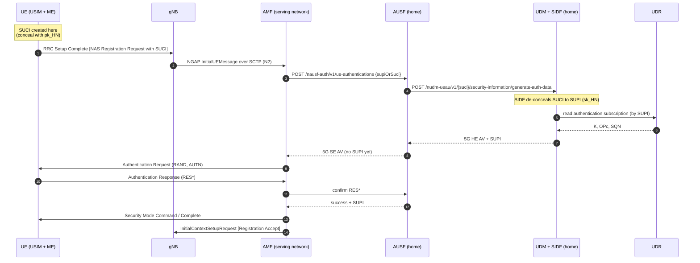
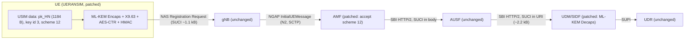

# 09. Technical deep dive: cryptography, 5G integration and findings

This document goes from simple to complex:

1. [How mobile networks protected identity before 5G](#1-identity-protection-before-5g)
2. [What 5G uses today: ECIES and the math behind it](#2-what-5g-uses-today-ecies)
3. [Why quantum computers break it](#3-why-quantum-computers-break-ecies)
4. [ML-KEM: how the replacement works](#4-ml-kem-how-the-replacement-works)
5. [Our construction: scheme 12 and scheme 13](#5-our-construction)
6. [Prior work](#6-prior-work)
7. [The 5G angle: flows, and how we changed the architecture](#7-the-5g-angle)
8. [Findings](#8-findings)
9. [References](#9-references)

Every number in section 8 comes from a file under `results/`, named next to it.

---

## 1. Identity protection before 5G

Every subscriber has a permanent identity, the IMSI (International Mobile Subscriber Identity):
MCC (country) + MNC (network) + MSIN (subscriber number), for example `999 70 0000000001`.

| Generation | How the permanent identity is protected on the radio |
|---|---|
| 2G (GSM) | Not encrypted. The phone sends the IMSI in clear on first attach, then a temporary TMSI. |
| 3G (UMTS) | Same idea: TMSI after the first attach; the network can still ask for the IMSI in clear. |
| 4G (LTE) | Same idea with the GUTI. The IMSI is still sent in clear when the network asks or has no valid GUTI. |
| 5G (NR) | The SUPI (permanent identity, usually the IMSI) is never sent in clear. The phone sends a SUCI: the MSIN encrypted with the home network's public key. |

The weakness in 2G to 4G is that an attacker with a fake base station (an "IMSI catcher") can
ask the phone for its identity, and the phone answers in clear. Temporary identities help only
while the network and phone agree on them.

5G fixes this with public-key encryption on the phone side. The phone needs no shared secret
with the visited network, only the home network's public key, which is stored on the USIM.

## 2. What 5G uses today: ECIES

The SUCI is computed with ECIES (Elliptic Curve Integrated Encryption Scheme), specified in
3GPP TS 33.501 Annex C. Two profiles exist:

| | Profile A | Profile B |
|---|---|---|
| Curve | Curve25519 (X25519 function) | secp256r1 (NIST P-256) |
| Ephemeral public key in SUCI | 32 bytes | 33 bytes (compressed point) |
| KDF | ANSI X9.63 with SHA-256 | same |
| Encryption | AES-128 in CTR mode | same |
| MAC | HMAC-SHA-256, truncated to 64 bits | same |

### 2.1 Elliptic curves in short

An elliptic curve over a prime field is the set of points (x, y) that satisfy an equation such as

- Curve25519 (Montgomery form): `y^2 = x^3 + 486662 x^2 + x  (mod p)`, `p = 2^255 - 19`
- P-256 (short Weierstrass form): `y^2 = x^3 - 3x + b  (mod p)`, with a fixed 256-bit prime `p`
  and constant `b`

Points can be "added" with a geometric rule, which makes the points a group. Adding a point `G`
to itself `k` times is written `k*G` (scalar multiplication).

- Computing `Q = k*G` from `k` is fast (double-and-add, about 256 steps).
- Finding `k` from `Q` and `G` is the **elliptic curve discrete logarithm problem** (ECDLP).
  The best known classical algorithms need about `2^128` operations for these curves.

A key pair is `(k, Q = k*G)`: `k` is private, `Q` is public.

### 2.2 Diffie-Hellman on a curve (ECDH)

Two parties with key pairs `(a, A = a*G)` and `(b, B = b*G)` both compute the same point:
`a*B = a*b*G = b*A`. An eavesdropper sees `A` and `B` but not `a*b*G`. The shared secret `Z` is
the x-coordinate of that point (32 bytes).

### 2.3 ECIES for the SUCI, step by step

The home network has a long-term key pair `(sk_HN, pk_HN)`. `pk_HN` and its key identifier are
on the USIM. `sk_HN` stays in the SIDF (Subscription Identifier De-concealing Function) in the
UDM.

UE side (conceal):

1. Generate a fresh ephemeral key pair `(e, E = e*G)`.
2. `Z = x-coordinate of e*pk_HN` (ECDH).
3. `K = X9.63-KDF(Z, SharedInfo = E)`, 64 bytes: `K_enc` (16) || `ICB` (16) || `K_mac` (32).
4. `C = AES-128-CTR(K_enc, ICB, MSIN)`; the MSIN is first packed as BCD digits (two digits per
   byte, swapped nibbles, so 10 digits become 5 bytes).
5. `T = first 8 bytes of HMAC-SHA-256(K_mac, C)`.
6. Scheme output = `E || C || T`.

Network side (SIDF): `Z = x-coordinate of sk_HN*E`, then the same KDF, check `T`, decrypt `C`.

The X9.63 KDF is simply `SHA-256(Z || counter || SharedInfo)` for counter = 1, 2, ...,
concatenated until enough bytes exist.

Because `e` is fresh every time, two SUCIs of the same subscriber look unrelated. That is what
stops tracking.

## 3. Why quantum computers break ECIES

Shor's algorithm (1994) solves the discrete logarithm problem, including the elliptic curve
version, in polynomial time on a large fault-tolerant quantum computer. Given the ephemeral
public key `E` from a recorded SUCI, such a machine finds `e`, computes `Z`, and decrypts the MSIN.

- The symmetric parts (SHA-256, AES-128, HMAC) are affected only by Grover's algorithm, which
  gives a square-root speedup on brute-force search. In practice this is considered far less
  urgent than Shor's attack on public-key schemes. We keep the Annex C symmetric layer unchanged
  so that only the public-key part differs between schemes.
- **Harvest now, decrypt later**: the attacker only needs to record traffic today. No quantum
  computer is needed at recording time. The SUPI is stable for years, so a decrypted recording
  still links a person to past places and times.

Such a quantum computer does not exist today, and nobody knows when one will. The cost of
migrating is the question this project measures.

## 4. ML-KEM: how the replacement works

ML-KEM (Module-Lattice-based Key-Encapsulation Mechanism) is standardized by NIST as FIPS 203.
It is the standardized form of CRYSTALS-Kyber.

### 4.1 KEM instead of Diffie-Hellman

A KEM has three algorithms:

- `KeyGen() -> (pk, sk)`
- `Encaps(pk) -> (ct, ss)`: produce a random 32-byte shared secret `ss` and a ciphertext `ct`.
- `Decaps(sk, ct) -> ss`

ECIES on the UE side can be read as a KEM too: "generate `e`, send `E`, keep `Z`". So replacing
ECDH with ML-KEM fits the same slot.

### 4.2 The hard problem: Learning With Errors

**Plain LWE (simple version).** Pick a secret vector `s` with entries mod `q`. Publish many
pairs `(a_i, b_i = <a_i, s> + e_i mod q)`, where `e_i` is a small random "error". Without the
errors, Gaussian elimination recovers `s` immediately. With the errors, no efficient classical
or quantum algorithm is known. This is the Learning With Errors problem (Regev, 2005).

**Module-LWE (what ML-KEM uses).** Instead of single numbers, the entries are polynomials in the
ring

```
R_q = Z_q[X] / (X^256 + 1),   q = 3329
```

so each element is a polynomial of degree below 256 with coefficients mod 3329, and
multiplication wraps around with `X^256 = -1`. Vectors and matrices have small dimension `k`:

| Parameter set | k | NIST security category | pk bytes | ct bytes | sk bytes |
|---|---|---|---|---|---|
| ML-KEM-512 | 2 | 1 | 800 | 768 | 1632 |
| ML-KEM-768 | 3 | 3 | 1184 | 1088 | 2400 |
| ML-KEM-1024 | 4 | 5 | 1568 | 1568 | 3168 |

(Sizes are FIPS 203 constants. Our liboqs build reports the same values; see
`results/processed/e2_sizes_computed.csv` for public key and scheme output sizes.)

### 4.3 The inner encryption scheme (K-PKE)

Small means "coefficients in a narrow range around 0", sampled from a centered binomial
distribution.

- **KeyGen**: expand a random seed into a public `k x k` matrix `A` of ring elements. Sample small
  `s` and `e`. Public key `t = A*s + e` (plus the seed). Secret key `s`.
- **Encrypt** a 32-byte message `m`: sample small `r`, `e1`, `e2`.
  `u = A^T * r + e1`, `v = t^T * r + e2 + round(q/2) * m`.
  Compress `u` and `v` (drop low bits) to save space. Ciphertext `(u, v)`.
- **Decrypt**: compute `v - s^T * u`. Expanding gives
  `round(q/2)*m + (e^T*r + e2 - s^T*e1)`. The bracket is small, so each coefficient is near 0
  or near `q/2`, and rounding recovers each bit of `m`.

For ML-KEM-768 the ciphertext compression uses 10 bits per coefficient for `u` and 4 bits for
`v`: `3*256*10/8 + 256*4/8 = 960 + 128 = 1088` bytes, which is the ciphertext size above.

### 4.4 From encryption to a secure KEM (Fujisaki-Okamoto transform)

K-PKE alone is only secure against passive attackers. ML-KEM wraps it with a variant of the
Fujisaki-Okamoto transform:

- **Encaps**: pick random `m`; derive `(K, r) = G(m || H(pk))`; `ct = K-PKE.Encrypt(pk, m; r)`
  using `r` as the randomness. The shared secret is `K`.
- **Decaps**: decrypt to `m'`, recompute `(K', r') = G(m' || H(pk))`, re-encrypt with `r'` and
  compare with `ct`. If equal, output `K'`. If not, output `J(z || ct)` for a secret random `z`
  ("implicit rejection"), so an attacker learns nothing from tampered ciphertexts.

This gives IND-CCA2 security, the standard notion for public-key encryption used in protocols.

### 4.5 Why it is fast

`q = 3329` is chosen so that the Number Theoretic Transform (NTT, an FFT over `Z_q`) can be used
to multiply polynomials. Multiplication then costs about `n log n` operations instead of `n^2`.
Optimized implementations, such as the AVX2 code in liboqs, make ML-KEM operations take
microseconds. Section 8 shows that on our machine ML-KEM is not slower than the elliptic curve
operations it replaces.

## 5. Our construction

The full design is in [03-pq-design.md](03-pq-design.md). In short:

| | ECIES Profile A | Scheme 12 (ML-KEM-768) | Scheme 13 (hybrid) |
|---|---|---|---|
| UE public-key step | X25519 with ephemeral key | `Encaps(pk_HN)` | both |
| KDF input `Z` | ECDH x-coordinate | ML-KEM shared secret | ECDH secret `||` ML-KEM secret |
| KDF SharedInfo | ephemeral public key | ML-KEM ciphertext | ephemeral key `||` ciphertext |
| Symmetric part | AES-128-CTR + HMAC-SHA-256/64 | same | same |
| Scheme output | 32 + 5 + 8 bytes | 1088 + 5 + 8 bytes | 32 + 1088 + 5 + 8 bytes |

The symmetric part is copied unchanged from Annex C, so the comparison isolates the cost of the
public-key part. Scheme 13 stays secure if either X25519 or ML-KEM stays secure.

Schemes 12 and 13 use identifiers from the range TS 23.003 reserves for home network proprietary
schemes. They are a research prototype, not a standard.

## 6. Prior work

- **5G identity privacy and its limits.** Koutsos (IEEE EuroS&P 2019) analyzed 5G-AKA privacy
  formally and showed attacks that remain even with SUCI. Park, Shaik, Borgaonkar and Seifert
  (ACM WPES 2019) studied commercial IMSI catchers. NIST CSWP 36A explains how operators enable
  SUCI.
- **Post-quantum SUCI.** Ulitzsch, Park, Marzougui and Seifert, "A Post-Quantum Secure
  Subscription Concealed Identifier for 6G" (ACM WiSec 2022), proposed a KEM-based SUCI and
  evaluated it, including on constrained hardware. A 2025 article in the journal *Information*
  (MDPI, vol. 16, no. 7, article 617), "Post-Quantum Key Exchange and Subscriber Identity
  Encryption in 5G Using ML-KEM (Kyber)", studies an ML-KEM-512 based SUCI profile.
- **Post-quantum 5G AKA.** Damir, Meskanen, Ramezanian and Niemi, "A Beyond-5G Authentication and
  Key Agreement Protocol" (NSS 2022, arXiv 2207.06144), redesign AKA with quantum resistance in
  mind.
- **Testbeds.** "Post-Quantum Cryptography Migration of a Physical 5G Testbed" (ACM, 2025,
  DOI 10.1145/3733820.3764679) reports a migration on physical equipment.
- **Primitives.** Shor (1994), Regev (2005), Bos et al. "CRYSTALS-Kyber" (IEEE EuroS&P 2018),
  NIST FIPS 203 (2024), Bernstein "Curve25519" (PKC 2006).

What this project adds: an end-to-end run of a KEM-based SUCI through a real open-source 5G core
path (UE, gNB, AMF, AUSF, UDM, then a PDU session), with every code change and every size or
format limit we hit listed by file and line, plus capacity measurements under attach storms.

## 7. The 5G angle

### 7.1 Where the SUCI travels



Key points:

- The SUCI crosses three transports: the radio (RRC, in the NAS message), N2 (NGAP over SCTP)
  and the SBI (HTTP/2 between network functions), where it appears as text in the URI path.
- The serving AMF never needs `sk_HN`. It learns the SUPI only after authentication succeeds.
- The SIDF is a function inside the UDM in the home network. The scheme is chosen by the home
  network, which is why proprietary scheme IDs exist.

### 7.2 What has to change for a post-quantum scheme

| Element | Role | Change needed | In this project |
|---|---|---|---|
| USIM | stores `pk_HN`, key ID, scheme list | room for a 1184-byte public key instead of 32 or 33 bytes | simulated: key in the UERANSIM UE config |
| ME / USIM compute | computes SUCI | ML-KEM Encaps + same DEM | UERANSIM patch (liboqs) |
| Radio (RRC) | carries NAS | larger first uplink message | no change (simulated radio); cost modeled in E5 |
| gNB | forwards NAS in NGAP | none (NAS-PDU is opaque) | no change |
| AMF | builds the SUCI string from NAS | must not reject unknown scheme IDs | patch: accept-list in 3 places |
| AUSF | forwards SUCI to UDM | none if the URI length is allowed | no change needed |
| UDM / SIDF | de-conceals | ML-KEM Decaps, key storage for a 2400-byte secret key, KDF for long SharedInfo | patch (liboqs, new key loader, new KDF) |
| UDR | subscriber data | none (indexed by SUPI) | no change |



### 7.3 Limits we found in the open-source implementations

Each item is a place where the code assumed elliptic-curve sizes or a fixed scheme list. The full
list with file and line is in [05-tier3-integration.md](05-tier3-integration.md).

- UERANSIM accepted only schemes 0 and 1, and only a 32-byte home network public key.
- UERANSIM's X9.63 KDF had both input lengths fixed to 32 bytes.
- The Open5GS AMF rejected any scheme ID other than 0, 1, 2 (Registration Reject, cause 95).
- The Open5GS SIDF stored the scheme output size in an 8-bit variable and assumed a fixed key and
  MSIN length; its KDF had a 69-byte input buffer guarded by an assertion (a longer input would
  abort the UDM process).
- The Open5GS `hnet` key table held 32-byte keys only.
- No limit was hit in NAS (16-bit length field), NGAP, UERANSIM's radio simulation (16384-byte
  limit), or the SBI HTTP/2 path with a 2226-character SUCI.

## 8. Findings

### 8.1 Size (E2)

From `results/processed/e2_sizes_computed.csv`:

| Scheme | HN public key (B) | Scheme output (B) | SUCI string (chars) | NAS mobile identity (B) |
|---|---|---|---|---|
| null | 0 | 5 | 33 | 15 |
| Profile A | 32 | 45 | 113 | 55 |
| Profile B | 33 | 46 | 115 | 56 |
| ML-KEM-512 (benchmark only) | 800 | 781 | 1586 | 791 |
| Scheme 12, ML-KEM-768 | 1184 | 1101 | 2226 | 1111 |
| ML-KEM-1024 (benchmark only) | 1568 | 1581 | 3186 | 1591 |
| Scheme 13, hybrid | 1216 | 1133 | 2290 | 1143 |

Scheme 12 makes the scheme output about 24 times larger than Profile A (1101 vs 45 bytes). The
same sizes were seen on the wire: the 5GS mobile identity in the scheme 12 capture has length
1109 (+2 length bytes = 1111), and the SBI URI carried a 2226-character SUCI
(`results/processed/tier3_interop.csv`).

### 8.2 Compute (E1, E6)

Python (`cryptography` for ECIES, liboqs-python for ML-KEM), median of three run medians on an idle
Intel Core i3-1005G1, 2000 iterations per run, from `results/processed/e1_repeatability.csv`:

| Scheme | Conceal (UE), us | De-conceal (SIDF), us |
|---|---|---|
| Profile A | 92.0 | 88.4 |
| Profile B | 142.7 | 149.1 |
| ML-KEM-512 (benchmark only) | 37.0 | 40.2 |
| Scheme 12, ML-KEM-768 | 41.8 | 44.4 |
| ML-KEM-1024 (benchmark only) | 45.9 | 50.7 |
| Scheme 13, hybrid | 131.7 | 129.0 |

Native liboqs (`speed_kem`), mean, from `results/processed/e1_native_liboqs.csv`: ML-KEM-768
keygen 10.9 us, encaps 9.8 us, decaps 12.0 us.

Inside the real stack, median de-conceal time in the Open5GS UDM (`results/processed/e6_native_timings.csv`):
598.5 us for Profile A, 1557.0 us for Profile B, 90.5 us for scheme 12.

So on this machine, post-quantum SUCI costs bytes, not CPU time. ML-KEM-768 is faster than both
ECIES profiles, and the hybrid costs about the sum of X25519 and ML-KEM.

### 8.3 Real core (E3, E4)

From `results/processed/summary.csv` (sources listed in `summary_notes.txt`):

| Scheme | Registered on core | NAS Registration Request (B) | Registration median, 1 UE (ms) | Registration median, 100 UEs (ms) | UDM CPU per UE, 100 UEs (ms) |
|---|---|---|---|---|---|
| null | yes | 25 | 33.4 | 856.5 | 3.67 |
| Profile A | yes | 65 | 29.2 | 805.7 | 5.40 |
| Profile B | yes (patched UE) | 66 | 27.5 | 806.2 | 6.07 |
| Scheme 12 | yes (patched UE, AMF, UDM) | 1121 | 26.2 | 725.7 | 4.07 |

Registration latency and UDM load with scheme 12 were not worse than with the ECIES profiles.
The differences between schemes are within the run-to-run variation.

### 8.4 Radio (E5 model)

Scheme 12 adds 1056 bytes to the first uplink message compared with Profile A
(`results/processed/e5_airtime.csv`). Under the stated model this is 10 extra 0.5 ms slots with a
10 PRB QPSK grant and 1 extra slot with 50 PRB 16QAM or any 273 PRB grant. The radio, not the
CPU, is where the post-quantum cost shows up. Discussion of all results:
[07-results-and-discussion.md](07-results-and-discussion.md).

## 9. References

- 3GPP TS 33.501, Security architecture and procedures for 5G System (Annex C: protection schemes).
- 3GPP TS 23.003, Numbering, addressing and identification (SUCI format, scheme identifiers).
- 3GPP TS 24.501, NAS protocol for 5GS (5GS mobile identity IE).
- NIST FIPS 203, Module-Lattice-Based Key-Encapsulation Mechanism Standard, 2024.
- NIST CSWP 36A, Protecting Subscriber Identifiers with Subscription Concealed Identifier (SUCI).
- P. W. Shor, Algorithms for quantum computation: discrete logarithms and factoring, FOCS 1994.
- O. Regev, On lattices, learning with errors, random linear codes, and cryptography, STOC 2005.
- J. Bos et al., CRYSTALS-Kyber: a CCA-secure module-lattice-based KEM, IEEE EuroS&P 2018.
- D. J. Bernstein, Curve25519: new Diffie-Hellman speed records, PKC 2006.
- A. Koutsos, The 5G-AKA authentication protocol privacy, IEEE EuroS&P 2019.
- S. Park, A. Shaik, R. Borgaonkar, J.-P. Seifert, Anatomy of commercial IMSI catchers and
  detectors, ACM WPES 2019.
- V. Q. Ulitzsch, S. Park, S. Marzougui, J.-P. Seifert, A post-quantum secure subscription
  concealed identifier for 6G, ACM WiSec 2022, DOI 10.1145/3507657.3528540.
- M. T. Damir, T. Meskanen, S. Ramezanian, V. Niemi, A beyond-5G authentication and key agreement
  protocol, NSS 2022, arXiv 2207.06144.
- Post-quantum key exchange and subscriber identity encryption in 5G using ML-KEM (Kyber),
  Information 16(7):617, MDPI, 2025.
- Post-quantum cryptography migration of a physical 5G testbed, ACM, 2025,
  DOI 10.1145/3733820.3764679.
